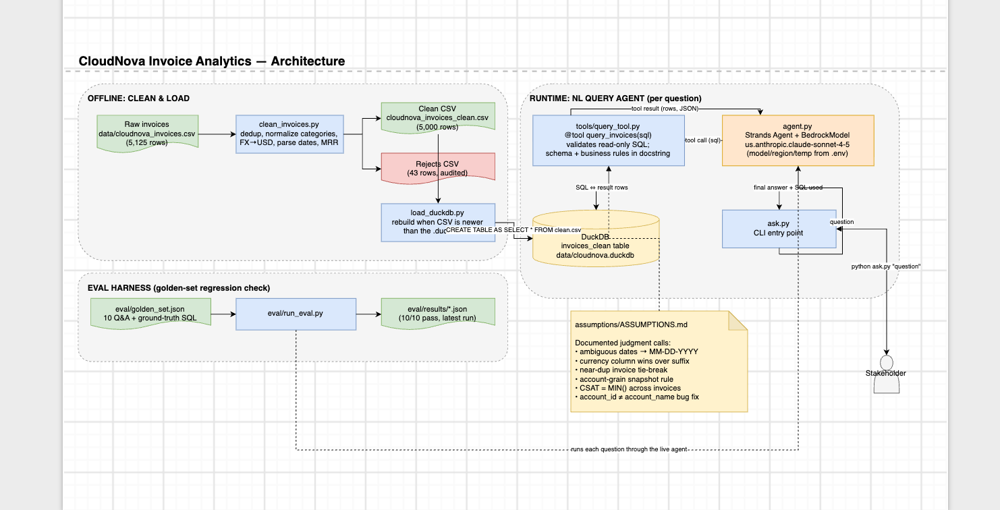

# CloudNova Invoice Analytics

## What this is

CloudNova's finance export (`data/cloudnova_invoices.csv`, ~5,000 invoices)
is dirty — it's stitched together from three systems that disagree with
each other, use inconsistent formats, and sometimes duplicate records.
Nobody owned data quality, so nobody fully trusts the numbers.

This project does two things:

1. **Cleans the data** into a single trustworthy table, with every
   judgment call made along the way written down and justified.
2. **Lets anyone ask questions about it in plain English** — "What was
   our total recognized revenue for paid invoices in 2024?" — and get a
   real answer, with the exact SQL that produced it, from the command line.

## Architecture



Offline, `clean_invoices.py` turns the raw export into a trustworthy table
and loads it into DuckDB. At query time, a Strands agent (Bedrock Claude)
turns a plain-English question into SQL against that table via a single
validated tool, and `ask.py` is the command-line front end to it. A
golden-set eval harness runs the same six-plus-four questions through the
live agent on demand to catch regressions. The source diagram
(`docs/architecture.drawio`) can be opened and edited directly in
[draw.io](https://app.diagrams.net).

## Why it's built this way

Dirty invoice data has a trap: you can write code that runs without
errors and still produces a confidently wrong number (duplicate invoices
double-counted, ambiguous dates silently misparsed, an account's revenue
averaged per-invoice instead of per-account). The fix isn't just "clean
the data" — it's making every non-obvious decision visible, so a
stakeholder can see *where* the numbers could be wrong and why, instead of
taking a dashboard on faith.

That's why this repo has an `assumptions/` folder: every place the raw
data was ambiguous and a real cleaning or query rule had to be invented —
not derived from stated business rules — is written down there, with the
reasoning and the measured effect on the output. Two bugs were caught and
fixed this way during testing (an invalid date-parsing rule, and a wrong
CSAT aggregation rule) — both are documented, not just silently patched.

## What's in the repo

| Path | What it is |
|---|---|
| `docs/BUSINESS_CONTEXT.md` | The business rules this was built against (pricing, revenue recognition, known data issues) — not written by us. |
| `spec/clean_invoices_spec.md` | Design doc for the cleaning step. |
| `spec/query_agent_spec.md` | Design doc for the question-answering agent. |
| `assumptions/ASSUMPTIONS.md` | **Every judgment call made, with reasoning and measured impact.** Read this before trusting a number. |
| `clean_invoices.py` | Cleans the raw CSV → `data/cloudnova_invoices_clean.csv` (+ a `_rejects.csv` of anything dropped, for audit). |
| `load_duckdb.py` | Loads the clean CSV into a local DuckDB database for fast querying. |
| `tools/query_tool.py`, `agent.py` | The question-answering agent: a Strands AI agent that writes and runs SQL against the clean data. |
| `ask.py` | **Command-line tool to ask a question.** |

## The numbers, as cleaned

- 5,125 raw invoice rows → **5,000 clean rows** (82 exact duplicates + 43
  conflicting duplicate invoice IDs removed — see `assumptions/ASSUMPTIONS.md` §3).
- **Recognized revenue (paid invoices):** $120,145,168.20
- **Refunds given back:** $8,923,203.77
- **Net revenue:** $111,221,964.43

## Known limitations (be aware before relying on these for decisions)

- Two question types — *average MRR per account* and *churn rate by
  plan* — require picking one "current" invoice to represent an account
  that may have billed many times. We use its most recent invoice; this
  is a reasonable default but not a verified business rule (see
  `assumptions/ASSUMPTIONS.md` §4).
- `region` is missing on ~25% of raw rows; any region-based answer is
  scoped to the rows that have it.
- 575 dates in the raw file were genuinely ambiguous (could be read two
  valid ways) and were resolved with a documented, not stakeholder-signed-off,
  convention (`assumptions/ASSUMPTIONS.md` §1).

## How to run it

**Requirements:** Python 3.11+, AWS credentials with Bedrock access
(`aws sts get-caller-identity` should succeed), and the
`claude-sonnet-4-5` model enabled in the Bedrock console for your region.

```bash
# 1. Install dependencies
pip install -r requirements.txt

# 2. Configure (copy and edit if your model/region differ)
cp .env.example .env

# 3. Clean the raw data (writes data/cloudnova_invoices_clean.csv)
python clean_invoices.py

# 4. Load it into DuckDB for querying
python load_duckdb.py

# 5. Ask a question
python ask.py "What was our total recognized revenue in USD for paid invoices in 2024?"

# Add --quiet to hide the agent's intermediate tool calls and just see the answer:
python ask.py --quiet "How much have we given back in refunds?"
```

Other questions this already answers correctly (see
`conversation_history/` for the full build log):

```bash
python ask.py "Which region has the highest average MRR per account?"
python ask.py "What's the churn rate among Enterprise accounts vs Starter?"
python ask.py "List the top 5 accounts by revenue, and flag any with CSAT <= 2."
python ask.py "How many invoices are stuck in pending/failed and what's the exposed dollar amount?"
```

Every answer includes the SQL that was run, so it can be checked rather
than taken on faith.
